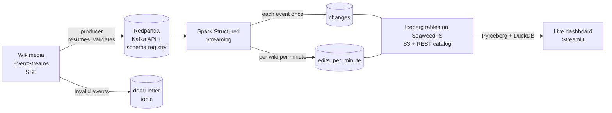

# Wikipedia edits, live: a streaming pipeline

[](https://github.com/OtoTediashvili/wiki-edits-streaming/actions/workflows/ci.yml)

Every edit on every Wikimedia wiki (Wikipedia in all languages, Wikidata,
Commons) is published as a public event stream, about 30 events a second.
This project takes that stream through a production-style streaming pipeline:



The whole design on one page, with the guarantees and the trade-offs:
[docs/architecture.md](docs/architecture.md).


**Status:** ingestion, the stream job and the live dashboard are done, with
unit, integration and end-to-end tests in CI, and the tables maintain
themselves (compaction, snapshot expiry).

## The data, measured

Before writing code I recorded 111 seconds of the live stream (3,675 events)
and profiled it. The design follows from these numbers.

| Measured | Value | What it decided |
|---|---|---|
| Rate | 33 events/s, median 1.4 KB each (~4 GB/day of JSON) | zstd compression; 48 h retention; Spark in local mode |
| Busiest wiki | Wikimedia Commons, 47% of events | partition by page, not by wiki |
| Event types | edit 46%, categorize 45%, log 7%, new page 2% | one topic, type as a field |
| No recent-changes id | 2% (some log types) | deduplicate on `meta.id`, which every event has |
| Edit → stream delay | median 1.7 s, p99 9.3 s, max 46 s | a dashboard seconds behind reality, not minutes |
| Out of order | 1.9% by more than 5 s, 0.05% by more than 30 s, none by more than 60 s | a minute is counted again whenever late events for it arrive |
| Bots | 29% of events | kept, flagged by `bot`, counted separately |

A 95-event slice of that recording, chosen to cover every event type and edge
case, is the test fixture.

## How the producer works

**Resumable.** EventStreams gives each event an id. The producer sends the
last one it delivered as `Last-Event-ID` when it reconnects, so a dropped
connection or a restart continues where it stopped, not from "now". The id
holds one position per Wikimedia datacenter, and a datacenter that hadn't
sent anything yet is resumed from the same moment as the others; left as it
was, it would resume from "now" (see "What went wrong on day one").

**At-least-once, never lossy.** Every 5 seconds the producer flushes and
waits until Redpanda has acknowledged everything sent; only then does it save
the resume position. A crash resends at most those 5 seconds, and the stream
job removes the duplicates by event id. A delivery failure stops the producer
without saving, so nothing is skipped. The Kafka producer itself is idempotent
(`acks=all`), so its own retries don't duplicate or reorder.

**Typed at the edge.** Each event becomes an Avro record (24 fields) checked
against a schema registered in Redpanda's schema registry. Consumers decode it
without guessing. The original JSON travels along in `raw`.

**Bad data versus bad infrastructure.** An event that can't be mapped or
doesn't fit the schema goes to `wiki.recentchange.dlq` with the reason in a
header, and the stream continues. A broker or registry failure crashes the
producer, the container restarts it, and it resumes.

**Polite client.** Wikimedia's User-Agent policy asks every client for a
contact; the producer refuses to start without one. Errors split by status:
429 and 5xx retry with exponential backoff, other 4xx stop. Wikimedia's
synthetic monitoring ("canary") events are skipped.

**Partitioned by page.** The message key is `wiki:title`. Keying by wiki would
put half the traffic (Commons) on one partition; a page key spreads load
evenly and still keeps each page's changes in order.

## How the stream job works

One Spark Structured Streaming query reads the topic in micro-batches (one
a minute, up to 200,000 events while catching up) and writes each batch into
two Iceberg tables:

| Table | What it holds | Updated |
|---|---|---|
| `wiki.changes` | every change, each event once, 26 typed columns, partitioned by day | appended every batch |
| `wiki.edits_per_minute` | per wiki and minute of event time: changes by type, bots vs humans, bytes added and removed, distinct editors | every minute a batch touched, counted again |

**Each event once, however late.** A batch drops copies of an event within
itself, then every event already in `changes` (an anti-join on the event
id), and appends the rest. An event that arrives three days late is written
like any other.

**Reads only what it touches.** Both steps read `changes` only for the
minutes the batch has events for, joined into ranges, so Iceberg skips every
other file. Some events carry timestamps years old (the logs show 2009,
2011, 2014); such an event adds a one-minute range, not the years between.

**Counts by event time, corrected by late data.** After the append, every
minute the batch has events for is counted again from `changes` and merged
into `edits_per_minute`. A late edit updates the minute it belongs to
instead of disappearing.

**Exactly-once, by idempotent writes.** After a crash Spark replays the
unfinished batch from its checkpoint. The anti-join finds its events already
written, and the minutes are counted again to the same numbers, even if the
crash came between the two writes. The tests replay batches, crash between
the writes, and check that nothing changes.

**What went wrong on day one.** The first version used Spark's stateful
operators: `dropDuplicatesWithinWatermark` and windowed counts in append
mode, with a 2-minute watermark taken from the measured lateness. Then the
laptop restarted. The producer resumed and replayed the three days of history
it had missed, but a few live events arrived mixed in with it. The watermark
moved to the newest of those, and from then on the job dropped every
replayed event as late:

```
{"query": "changes", "rows": 19998, "late_rows_dropped": 19998, "watermark": "2026-10-19T06:19:11.000Z", ...}
```

Two bugs, one in each half:

- *The producer.* The resume id holds a position per datacenter, and the
  quiet one (codfw) had sent nothing since the producer connected, so its
  position was `offset: -1`, which EventStreams reads as "from now". The busy
  datacenter resumed from where it stopped, the quiet one from the present,
  and its live events landed in the middle of the replay. (Afterwards the
  newest minutes in the lake, hours ahead of the replay, held two events
  each.) Now a datacenter without a position resumes from the same moment
  as the others, a minute early to be safe; the job drops the overlap.
- *The stream job.* A watermark is the right tool when events arrive nearly
  in order, and on the live stream they do. But this pipeline replays history
  by design (the producer never skips), so lateness can't be a reason to lose
  data. The redesign keeps no streaming state at all; the tables are the
  state. The end-to-end test now sends an event three days older than
  everything already processed and checks it lands.

**Loud on data loss.** If the job is stopped longer than Redpanda's 48-hour
retention, the messages it never read are gone. It then stops with an error
(`failOnDataLoss`) rather than skipping the gap silently. To accept the gap,
start it once with `WIKISTREAM_FAIL_ON_DATA_LOSS=false` in `.env`, then
remove the line.

**Messages that don't decode are set aside, not fatal.** Anything in the
topic that isn't a WikiChange record (plain bytes, an empty message, a
schema the job doesn't know) goes to `wiki.rejected` with its partition,
offset, bytes and the reason, and the batch carries on. The first version
stopped the job instead: the producer validates every record, so a bad one
"can only be a bug". True, but Spark then retried the same batch after every
restart, and the lake stopped until someone edited the checkpoint by hand.
Set-aside messages are logged at WARNING and counted by `make peek`, so a
schema mismatch can't hide.

**What is not stored.** `raw`, the original JSON, stays in Redpanda for 48
hours and is left out of Iceberg, which would otherwise be five times larger
on a laptop disk. A field that becomes interesting goes into the Avro schema,
and the last 48 hours can be reprocessed from Redpanda.

**Storage and catalog: SeaweedFS.** One small container provides S3-compatible
object storage and an Iceberg REST catalog on top of it. Spark and PyIceberg
talk to it as they would to a cloud catalog and S3 (OAuth2 client
credentials, path-style S3). MinIO was the original choice; its community
edition stopped shipping images in 2025. One quirk, found by capturing the
exact request Spark sends: Spark numbers a new table's columns from 0, and
SeaweedFS's catalog refuses a partition on column 0. So no table here is
partitioned by its first column, and a check refuses DDL that would be.

## The dashboard

`make dashboard` serves it on http://localhost:8501. It reads the same two
Iceberg tables through the same REST catalog, redraws itself every 30
seconds, and writes nothing.

- **Status line:** *Live*, *Catching up* (with how far behind the clock the
  newest counts are) or *Stalled* (no commit from the job for 5 minutes,
  with the command to check it). During a replay, the few live changes
  counted hours ahead of the rest don't make it *Live*: the page goes by
  the newest full minute and says how many are ahead.
- **Six numbers for the window:** changes per minute, edits, new pages, bot
  share, distinct editors, net bytes added.
- **Changes per minute,** people and bots, with a crosshair and the exact
  numbers on hover.
- **The busiest wikis,** split into people and bots.
- **The pages the most people are editing, and the newest pages,** with
  links to them.

A window (15 minutes to 24 hours) and a wiki can be picked, and both go into
the URL, so `?window=6h&wiki=dewiki` is a link to that view.

**How it reads.** PyIceberg fetches only what the view needs: the per-minute
counts in the window, and single changes for at most the last hour.
Iceberg's per-file min/max statistics let a time filter skip every file
outside the window, so a read costs the same on day one as on day thirty.
Freshness (the newest minute, the last commit) comes from table metadata
alone and opens no data file. DuckDB then runs the SQL inside the process,
over the Arrow tables PyIceberg returned. No query engine to run: the whole
container uses about 300 MB.

**Numbers that don't lie:**

- *Only complete minutes.* The newest minute is still filling (the job
  writes every minute, and events arrive seconds late), so the window ends
  where it begins. Otherwise every chart would end in a drop that isn't
  there.
- *Distinct means distinct.* Editors are counted from single changes, never
  by adding up per-minute counts: someone active in 30 minutes is one
  editor, not 30.
- *The window follows the lake, not the clock.* After time away it shows
  the newest counts there are, labelled with how far behind they are.
- *A quiet wiki's empty minutes count as zero.* Its rate is per minute of
  the window, not per minute it happened to have edits.

**Found by looking at it.** The tests passed; a browser set to Tbilisi time
then showed 06:18 on the axis for 10:18 UTC. Times without a zone reach the
chart as the viewer's local time, so they now go out as UTC instants on a
UTC scale, and a test checks the serialized chart. The same session found
that one theme setting had switched off dark mode.

The first hour of real data found the next one. The "most edited pages"
were Wikidata items with up to 101 edits each, every one by a single
person running a tool: semi-automated tools aren't flagged as bots, so
leaving bots out didn't catch them. Pages are now ranked by how many
different people edited them, which brings up what people are actually
working on.

## Keeping the tables healthy

A streaming job that commits every minute leaves things behind, and on a
laptop disk they add up:

- **Small files.** `changes` gets one data file per batch, about 1,440 a
  day. Every reader opens each of them, one S3 request apiece.
- **Superseded versions.** `edits_per_minute` is copy-on-write: each MERGE
  rewrites the data file holding today's minutes. The table stays at about
  one file a day, but every version it replaced stays on disk while any
  snapshot still points to it.
- **Snapshots.** One per commit per table, each listed in the metadata file
  that every commit and every reader loads.

`make peek` shows all three for each table: rows and files now (today's
and every other day's), how many snapshots are kept and how old the oldest
is, and what the table takes on disk against what the current snapshot
needs.

**Measured on the laptop,** after a day of streaming with maintenance
running:

| Table | Current data | On disk | Snapshots kept |
|---|---|---|---|
| `changes` | 12.1 million rows, 780 MB in 421 files | 1.5 GB | 349, the oldest 6 h old |
| `edits_per_minute` | 427,000 rows, 4.6 MB in 111 files | 238 MB | 345, the oldest 6 h old |

The minute table shows what copy-on-write costs: 98% of its footprint is
versions the job has since replaced, kept by six hours of snapshots. That's
about 40 MB an hour, so without expiry a 5 MB table would grow by roughly
a gigabyte a day. In `changes`, most of the extra 700 MB is the small files
compaction has replaced. They're deleted once the last snapshot that lists
them is six hours old.

**What runs.** Iceberg's own Spark procedures, once an hour inside the
stream job (between its batches, in the same Spark session, so no second
JVM), and on demand with `make maintain`:

1. `rewrite_data_files` on `changes`, for the days that have ended (UTC):
   the day's small files become one or two of up to 128 MB. Only days with
   five or more small files qualify, so a late event added to a compacted
   day doesn't trigger rewriting the whole day.
2. `expire_snapshots` on both tables: snapshots older than six hours go
   (the last ten always stay), and with them every data, manifest and
   manifest-list file only they referenced.

**Why it can run while the job writes.** Iceberg commits are optimistic:
two writers conflict only if one changes files the other depends on.
Compaction touches only days that have ended, and the job only appends to
`changes`, so rewriting yesterday and appending today never conflict.
The minute table, which the job rewrites, is never compacted. Expiry only
removes snapshots nothing reads any more. And one task failing (say a
compaction that lost a race with a straggler's commit) is logged, and the
others still run.

**What it leaves alone.** Orphan files, written by a batch that crashed
before it committed. Removing them means listing the warehouse through a
Hadoop file system the Spark image doesn't have. With idempotent batches
they are rare, and `make peek`'s disk figure includes them.

**How it's tested.** The end-to-end test runs the job in small batches, so
the recorded day lands as many small files. It then runs `maintain` in
the Spark image, with every snapshot but the last old enough to expire,
and checks the result: the day is one file, one snapshot is left, there
are fewer objects and fewer bytes on disk, the rows are the same, and
every lake and dashboard check passes unchanged. Unit tests cover what
each run does, that Spark's parser accepts every call, that a failed task
doesn't stop the rest, and that the hourly schedule can't take the stream
job down.

## Failure drills

"Exactly once" is a claim until something breaks. The drills break the
running pipeline on purpose, then check the lake against the topic.

| Drill | What breaks | What should happen |
|---|---|---|
| `producer-crash` | `kill -9` the producer between two checkpoints | It resumes from its saved position and resends up to 5 s of events; the lake keeps one copy of each |
| `job-crash` | `kill -9` the Spark job in the middle of a batch, three times | Spark replays the unfinished batch; the idempotent writes change nothing already written |
| `storage-outage` | SeaweedFS (catalog and S3) stopped for 2 minutes | Batches fail, the job exits, Docker restarts it until storage is back, and it catches up |
| `broker-outage` | Redpanda stopped for 1 minute | Producer and job exit and are restarted; the producer fetches what it missed from Wikimedia |
| `poison-message` | Two malformed messages written straight to the topic | The job sets them aside in `wiki.rejected` and carries on |

**How "nothing lost, nothing twice" is checked.** Before breaking anything,
the drill notes where each partition of the topic ends, and after recovery,
where they end again. It reads every message in between, decoded the way
the producer encoded it, and then audits the lake:

- every event sent is in `changes` exactly once, however often it was sent;
- every message that isn't a WikiChange is in `rejected`;
- every minute those events fall in is counted right, wiki by wiki.

It checks until the lake passes or 20 minutes are up, and the report in
`docs/drills/` records what was done when, the counts, and how long after
the broken part was back the lake had everything. The job is caught in the
middle of a batch through Spark's REST API, not by luck.

A drill only starts once the job is live: its newest *full* minute (100
changes or more) within 5 minutes of the clock. Not just its newest minute:
while the producer replays a gap, a few live changes from Wikimedia's
quieter datacenter get counted hours ahead of the rest, and a check on the
newest minute alone would start a drill hours before the job is ready.

What breaks what, and what to do about each, is in the
[runbook](docs/runbook.md).

## Run it

Needs Docker, [uv](https://docs.astral.sh/uv/) 0.11.32 or newer, make, and
Java 17 or 21 for the Spark unit tests (`sudo apt install openjdk-21-jre-headless`).

```bash
make install              # .venv from uv.lock, git hooks
cp .env.example .env      # then set WIKISTREAM_CONTACT (your GitHub URL or email)
make check                # lint, strict types, unit tests (Spark ones included)

make up                   # Redpanda, Console (:8090), SeaweedFS (admin UI :12646)
make produce              # stream live edits; make logs to follow, make stop to stop
make stream               # the Spark job; make stream-logs, Spark UI on :4040
make dashboard            # the live dashboard on :8501
make peek                 # table sizes, disk use and the newest minutes, in the terminal
make maintain             # compact and expire snapshots now (the job also does it hourly)
make drill NAME=list      # the failure drills; make drill NAME=job-crash runs one

make test-integration     # producer -> Redpanda -> consumer
make test-e2e             # recording -> Redpanda -> Spark -> Iceberg, read back
```

`make help` lists everything. `make down` stops the stack and keeps the data;
`make reset` deletes it all. `make lake-reset` empties only the lake (tables
and checkpoint); the next `make stream` rebuilds it from the topic, which is
the point of keeping the log.

Memory, for an 8 GB laptop: Redpanda is capped at 1 GB, Spark's driver at
1 GB of heap (roughly 1.5 GB with the JVM around it), SeaweedFS uses about
200 MB and the dashboard about 300 MB. The whole stack fits in roughly 3.5 GB.

## Tests

- **215 unit tests** (`make test`), no network or Docker:
  - the producer: SSE parsing, field mapping and validation against the real
    recording, reconnect and resume against mocked HTTP responses (including
    a datacenter with no position yet, for every id in the recording), the
    checkpoint logic against a fake producer and an in-memory schema registry;
  - the stream job, on a local Spark: table rows and types, per-minute counts
    against a count by hand, and the batch writer over many batches against
    an in-memory table store: copies written once, events from earlier
    batches not written again, events days late written and their minutes
    corrected, a replayed batch changing nothing, a crash between the two
    writes repaired by the replay, an event from 2009 read as a one-minute
    range instead of seventeen years. One test runs the writer inside a real
    streaming query and restarts it from its checkpoint. Spark's own parser
    checks the table DDL;
  - the dashboard, over real Iceberg tables in a temporary folder (a SQLite
    catalog instead of SeaweedFS): every number against a count by hand,
    reads that open only the files in the window, freshness from metadata
    alone, and the whole page run headless with Streamlit's AppTest, live,
    catching up, stalled, before any table exists and with the catalog
    down;
  - maintenance: what each run does, Spark's parser over every procedure
    call, a failed task not stopping the rest, the hourly schedule, and
    `make peek`'s disk figures on tables with superseded files;
  - the quarantine: malformed, headerless and empty messages set aside
    with the right reason, a batch of nothing but those, and a replay that
    sets nothing aside twice;
  - the drills, with the stack, the topic and the lake faked: what each
    drill breaks and in what order, the audit's verdict for each kind of
    failure, reading a window of the topic, and the report.
- **Integration tests** (`make test-integration`): the recording goes through
  the real producer, Redpanda and schema registry and is read back by a
  consumer; topic retention and repeatable topic creation are checked.
- **End-to-end test** (`make test-e2e`): the recording is produced twice into
  a fresh topic and the Spark image runs the job; then an event three days
  older than all of it arrives and the job runs again. After each run
  PyIceberg reads the tables back: every event exactly once, and per-minute
  counts that agree with the rows. Then the dashboard is rendered over what
  Spark wrote, and each of its numbers is checked against the same number
  counted from the rows. Two malformed messages ride along in the topic and
  must end up in `wiki.rejected`, decoded by the real Spark image. Last,
  maintenance runs in the Spark image, and the same checks pass on fewer
  files and less disk.
- The tests were checked by breaking the code on purpose: forgetting the
  resume id, resuming a datacenter from "now", retrying a 4xx, saving the position before the broker confirms,
  keeping canaries, skipping schema validation, not checking which events
  are already written, not removing copies within a batch, counting only a
  batch's new events, dropping late events, checking only some of a batch's
  time ranges, reading one range from the oldest event to the newest,
  swapping bots and humans; and on the dashboard, counting the minute still
  filling, adding up editors instead of counting distinct ones, reading
  every file and filtering afterwards, letting bots into the page list,
  ranking one person's tool run above a page several people are editing,
  sending chart times without a zone; in maintenance, compacting today,
  expiring without keeping the last snapshots, letting one failed task stop
  the rest; and in the quarantine and the drills, letting a reject become a
  change, setting a replayed reject aside twice, logging rejects quietly,
  an audit that misses a lost event, a double, an unquarantined message or
  a count with no rows behind it, and a window that reads one message past
  its end. Each break fails a test.

CI runs all of it: lint, strict mypy, unit tests, the integration and
end-to-end tests against the same `docker-compose.yml`, all three image
builds (each started once), and a full-history secret scan.

## Layout

```
src/wikistream/
  sse.py              Server-Sent Events parser (a pure function: lines in, events out)
  source.py           the live connection: reconnect, backoff, resume
  model.py            event JSON -> WikiChange record; validation
  wiki_change.avsc    the Avro schema
  producer.py         topics, checkpointing, dead-letter routing
  state.py            the resume position, saved atomically
  config.py           typed settings from WIKISTREAM_* variables
  streaming/
    transform.py      decode, table rows, deduplication, per-minute counts, time ranges
    tables.py         Iceberg DDL, generated from the column specs
    session.py        Spark configuration: connectors, catalog, logging
    job.py            the batch writer, the query, supervision, progress logging
    maintenance.py    compaction and snapshot expiry, hourly and on demand
    catalog.py        the REST catalog for Python readers (PyIceberg)
    peek.py           read the tables from the host with PyIceberg: sizes, disk use
  drills/
    topic.py          where each partition ends; the messages in between, decoded
    audit.py          the verdict: every event once, poison set aside, minutes right
    drills.py         the five drills, the runner, the report
  dashboard/
    lake.py           what the page reads: time-bounded scans, freshness from metadata
    queries.py        every number on the page, as DuckDB SQL over Arrow
    app.py            the Streamlit page: status, filters, numbers, charts, tables
tests/                unit, integration and end-to-end tests, the recorded fixture
docker-compose.yml    Redpanda, Console, SeaweedFS, producer, Spark job, dashboard
Dockerfile            producer image
spark.Dockerfile      Spark job image, connector jars fetched at build time
dashboard.Dockerfile  dashboard image: no Spark, no Java
docs/runbook.md       each failure: what you see, what happens on its own, what to do
docs/drills/          the drills' reports
```

## Stack

Python 3.12, uv, confluent-kafka, httpx, pydantic-settings, structlog ·
Redpanda (Kafka API, schema registry), Redpanda Console · Apache Spark 4.0
Structured Streaming, Apache Iceberg 1.11, SeaweedFS (S3, Iceberg REST
catalog), PyIceberg · Streamlit, DuckDB, Altair · Docker Compose · pytest, respx, mypy (strict), ruff,
pre-commit, gitleaks · GitHub Actions.

Event data: [Wikimedia EventStreams](https://wikitech.wikimedia.org/wiki/Event_Platform/EventStreams_HTTP_Service).
