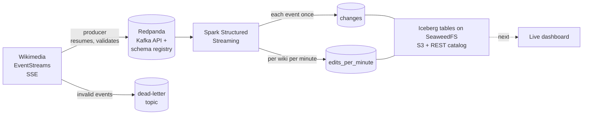

# Wikipedia edits, live: a streaming pipeline

[](https://github.com/OtoTediashvili/wiki-edits-streaming/actions/workflows/ci.yml)

Every edit on every Wikimedia wiki (Wikipedia in all languages, Wikidata,
Commons) is published as a public event stream, about 30 events a second.
This project takes that stream through a production-style streaming pipeline:



**Status:** ingestion and the stream job are done, with unit, integration and
end-to-end tests in CI. The dashboard comes next.

## The data, measured

Before writing code I recorded 111 seconds of the live stream (3,675 events)
and profiled it. The design follows from these numbers.

| Measured | Value | What it decided |
|---|---|---|
| Rate | 33 events/s, median 1.4 KB each (~4 GB/day of JSON) | zstd compression; 48 h retention; Spark in local mode |
| Busiest wiki | Wikimedia Commons, 47% of events | partition by page, not by wiki |
| Event types | edit 46%, categorize 45%, log 7%, new page 2% | one topic, type as a field |
| No recent-changes id | 2% (some log types) | deduplicate on `meta.id`, which every event has |
| Edit → stream delay | median 1.7 s, p99 9.3 s, max 46 s | a dashboard seconds behind reality, not minutes |
| Out of order | 1.9% by more than 5 s, 0.05% by more than 30 s, none by more than 60 s | a minute is counted again whenever late events for it arrive |
| Bots | 29% of events | kept, flagged by `bot`, counted separately |

A 95-event slice of that recording, chosen to cover every event type and edge
case, is the test fixture.

## How the producer works

**Resumable.** EventStreams gives each event an id. The producer sends the
last one it delivered as `Last-Event-ID` when it reconnects, so a dropped
connection or a restart continues where it stopped, not from "now". The id
holds one position per Wikimedia datacenter, and a datacenter that hadn't
sent anything yet is resumed from the same moment as the others; left as it
was, it would resume from "now" (see "What went wrong on day one").

**At-least-once, never lossy.** Every 5 seconds the producer flushes and
waits until Redpanda has acknowledged everything sent; only then does it save
the resume position. A crash resends at most those 5 seconds, and the stream
job removes the duplicates by event id. A delivery failure stops the producer
without saving, so nothing is skipped. The Kafka producer itself is idempotent
(`acks=all`), so its own retries don't duplicate or reorder.

**Typed at the edge.** Each event becomes an Avro record (24 fields) checked
against a schema registered in Redpanda's schema registry. Consumers decode it
without guessing. The original JSON travels along in `raw`.

**Bad data versus bad infrastructure.** An event that can't be mapped or
doesn't fit the schema goes to `wiki.recentchange.dlq` with the reason in a
header, and the stream continues. A broker or registry failure crashes the
producer, the container restarts it, and it resumes.

**Polite client.** Wikimedia's User-Agent policy asks every client for a
contact; the producer refuses to start without one. Errors split by status:
429 and 5xx retry with exponential backoff, other 4xx stop. Wikimedia's
synthetic monitoring ("canary") events are skipped.

**Partitioned by page.** The message key is `wiki:title`. Keying by wiki would
put half the traffic (Commons) on one partition; a page key spreads load
evenly and still keeps each page's changes in order.

## How the stream job works

One Spark Structured Streaming query reads the topic in micro-batches (one
a minute, up to 200,000 events while catching up) and writes each batch into
two Iceberg tables:

| Table | What it holds | Updated |
|---|---|---|
| `wiki.changes` | every change, each event once, 26 typed columns, partitioned by day | appended every batch |
| `wiki.edits_per_minute` | per wiki and minute of event time: changes by type, bots vs humans, bytes added and removed, distinct editors | every minute a batch touched, counted again |

**Each event once, however late.** A batch drops copies of an event within
itself, then every event already in `changes` (an anti-join on the event
id), and appends the rest. An event that arrives three days late is written
like any other.

**Reads only what it touches.** Both steps read `changes` only for the
minutes the batch has events for, joined into ranges, so Iceberg skips every
other file. Some events carry timestamps years old (the logs show 2009,
2011, 2014); such an event adds a one-minute range, not the years between.

**Counts by event time, corrected by late data.** After the append, every
minute the batch has events for is counted again from `changes` and merged
into `edits_per_minute`. A late edit updates the minute it belongs to
instead of disappearing.

**Exactly-once, by idempotent writes.** After a crash Spark replays the
unfinished batch from its checkpoint. The anti-join finds its events already
written, and the minutes are counted again to the same numbers, even if the
crash came between the two writes. The tests replay batches, crash between
the writes, and check that nothing changes.

**What went wrong on day one.** The first version used Spark's stateful
operators: `dropDuplicatesWithinWatermark` and windowed counts in append
mode, with a 2-minute watermark taken from the measured lateness. Then the
laptop restarted. The producer resumed and replayed the three days of history
it had missed, but a few live events arrived mixed in with it. The watermark
moved to the newest of those, and from then on the job dropped every
replayed event as late:

```
{"query": "changes", "rows": 19998, "late_rows_dropped": 19998, "watermark": "2026-10-19T06:19:11.000Z", ...}
```

Two bugs, one in each half:

- *The producer.* The resume id holds a position per datacenter, and the
  quiet one (codfw) had sent nothing since the producer connected, so its
  position was `offset: -1`, which EventStreams reads as "from now". The busy
  datacenter resumed from where it stopped, the quiet one from the present,
  and its live events landed in the middle of the replay. (Afterwards the
  newest minutes in the lake, hours ahead of the replay, held two events
  each.) Now a datacenter without a position resumes from the same moment
  as the others, a minute early to be safe; the job drops the overlap.
- *The stream job.* A watermark is the right tool when events arrive nearly
  in order, and on the live stream they do. But this pipeline replays history
  by design (the producer never skips), so lateness can't be a reason to lose
  data. The redesign keeps no streaming state at all; the tables are the
  state. The end-to-end test now sends an event three days older than
  everything already processed and checks it lands.

**Loud on data loss.** If the job is stopped longer than Redpanda's 48-hour
retention, the messages it never read are gone. It then stops with an error
(`failOnDataLoss`) rather than skipping the gap silently. To accept the gap,
start it once with `WIKISTREAM_FAIL_ON_DATA_LOSS=false` in `.env`, then
remove the line.

**What is not stored.** `raw`, the original JSON, stays in Redpanda for 48
hours and is left out of Iceberg, which would otherwise be five times larger
on a laptop disk. A field that becomes interesting goes into the Avro schema,
and the last 48 hours can be reprocessed from Redpanda.

**Storage and catalog: SeaweedFS.** One small container provides S3-compatible
object storage and an Iceberg REST catalog on top of it. Spark and PyIceberg
talk to it as they would to a cloud catalog and S3 (OAuth2 client
credentials, path-style S3). MinIO was the original choice; its community
edition stopped shipping images in 2025. One quirk, found by capturing the
exact request Spark sends: Spark numbers a new table's columns from 0, and
SeaweedFS's catalog refuses a partition on column 0. So no table here is
partitioned by its first column, and a check refuses DDL that would be.

## Run it

Needs Docker, [uv](https://docs.astral.sh/uv/) 0.11.32 or newer, make, and
Java 17 or 21 for the Spark unit tests (`sudo apt install openjdk-21-jre-headless`).

```bash
make install              # .venv from uv.lock, git hooks
cp .env.example .env      # then set WIKISTREAM_CONTACT (your GitHub URL or email)
make check                # lint, strict types, unit tests (Spark ones included)

make up                   # Redpanda, Console (:8090), SeaweedFS (admin UI :12646)
make produce              # stream live edits; make logs to follow, make stop to stop
make stream               # the Spark job; make stream-logs, Spark UI on :4040
make peek                 # table sizes and the newest minutes

make test-integration     # producer -> Redpanda -> consumer
make test-e2e             # recording -> Redpanda -> Spark -> Iceberg, read back
```

`make help` lists everything. `make down` stops the stack and keeps the data;
`make reset` deletes it all. `make lake-reset` empties only the lake (tables
and checkpoint); the next `make stream` rebuilds it from the topic, which is
the point of keeping the log.

Memory, for an 8 GB laptop: Redpanda is capped at 1 GB, Spark's driver at
1 GB of heap (roughly 1.5 GB with the JVM around it), SeaweedFS uses about
200 MB. The whole stack fits in roughly 3 GB.

## Tests

- **95 unit tests** (`make test`), no network or Docker:
  - the producer: SSE parsing, field mapping and validation against the real
    recording, reconnect and resume against mocked HTTP responses (including
    a datacenter with no position yet, for every id in the recording), the
    checkpoint logic against a fake producer and an in-memory schema registry;
  - the stream job, on a local Spark: table rows and types, per-minute counts
    against a count by hand, and the batch writer over many batches against
    an in-memory table store: copies written once, events from earlier
    batches not written again, events days late written and their minutes
    corrected, a replayed batch changing nothing, a crash between the two
    writes repaired by the replay, an event from 2009 read as a one-minute
    range instead of seventeen years. One test runs the writer inside a real
    streaming query and restarts it from its checkpoint. Spark's own parser
    checks the table DDL.
- **Integration tests** (`make test-integration`): the recording goes through
  the real producer, Redpanda and schema registry and is read back by a
  consumer; topic retention and repeatable topic creation are checked.
- **End-to-end test** (`make test-e2e`): the recording is produced twice into
  a fresh topic and the Spark image runs the job; then an event three days
  older than all of it arrives and the job runs again. After each run
  PyIceberg reads the tables back: every event exactly once, and per-minute
  counts that agree with the rows.
- The tests were checked by breaking the code on purpose: forgetting the
  resume id, resuming a datacenter from "now", retrying a 4xx, saving the position before the broker confirms,
  keeping canaries, skipping schema validation, not checking which events
  are already written, not removing copies within a batch, counting only a
  batch's new events, dropping late events, checking only some of a batch's
  time ranges, reading one range from the oldest event to the newest,
  swapping bots and humans. Each break fails a test.

CI runs all of it: lint, strict mypy, unit tests, the integration and
end-to-end tests against the same `docker-compose.yml`, both image builds,
and a full-history secret scan.

## Layout

```
src/wikistream/
  sse.py              Server-Sent Events parser (a pure function: lines in, events out)
  source.py           the live connection: reconnect, backoff, resume
  model.py            event JSON -> WikiChange record; validation
  wiki_change.avsc    the Avro schema
  producer.py         topics, checkpointing, dead-letter routing
  state.py            the resume position, saved atomically
  config.py           typed settings from WIKISTREAM_* variables
  streaming/
    transform.py      decode, table rows, deduplication, per-minute counts, time ranges
    tables.py         Iceberg DDL, generated from the column specs
    session.py        Spark configuration: connectors, catalog, logging
    job.py            the batch writer, the query, supervision, progress logging
    peek.py           read the tables from the host with PyIceberg
tests/                unit, integration and end-to-end tests, the recorded fixture
docker-compose.yml    Redpanda, Console, SeaweedFS, producer, Spark job
Dockerfile            producer image
spark.Dockerfile      Spark job image, connector jars fetched at build time
```

## Stack

Python 3.12, uv, confluent-kafka, httpx, pydantic-settings, structlog ·
Redpanda (Kafka API, schema registry), Redpanda Console · Apache Spark 4.0
Structured Streaming, Apache Iceberg 1.11, SeaweedFS (S3, Iceberg REST
catalog), PyIceberg · Docker Compose · pytest, respx, mypy (strict), ruff,
pre-commit, gitleaks · GitHub Actions.

Event data: [Wikimedia EventStreams](https://wikitech.wikimedia.org/wiki/Event_Platform/EventStreams_HTTP_Service).
