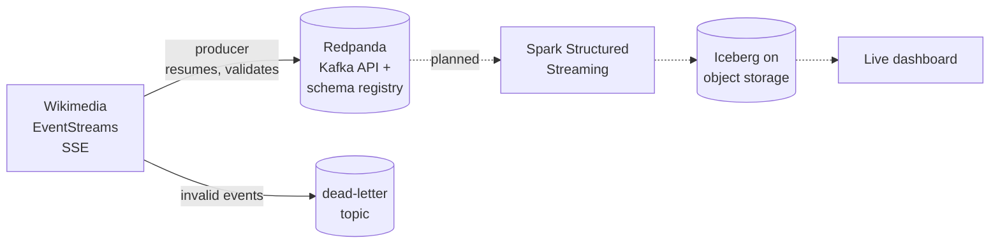

# Wikipedia edits, live: a streaming pipeline

[](https://github.com/OtoTediashvili/wiki-edits-streaming/actions/workflows/ci.yml)

Every edit on every Wikimedia wiki (Wikipedia in all languages, Wikidata,
Commons) is published as a public event stream, about 30 events a second.
This project takes that stream through a production-style streaming pipeline:



**Status:** ingestion is done: the producer, Redpanda and the tests. Spark,
Iceberg and the dashboard come next.

## The data, measured

Before writing code I recorded 111 seconds of the live stream (3,675 events)
and profiled it. The design follows from these numbers.

| Measured | Value | What it decided |
|---|---|---|
| Rate | 33 events/s, median 1.4 KB each (~4 GB/day of JSON) | zstd compression; 48 h retention |
| Busiest wiki | Wikimedia Commons, 47% of events | partition by page, not by wiki |
| Event types | edit 46%, categorize 45%, log 7%, new page 2% | one topic, type as a field |
| No recent-changes id | 2% (some log types) | deduplicate on `meta.id`, which every event has |
| Edit → stream delay | median 1.7 s, p99 9.3 s, max 46 s | a dashboard seconds behind reality, not minutes |
| Out of order | 1.9% by more than 5 s, 0.05% by more than 30 s, none by more than 60 s | 2-minute watermark in the stream job |
| Bots | 29% of events | kept, flagged by `bot` |

A 95-event slice of that recording, chosen to cover every event type and edge
case, is the test fixture.

## How the producer works

**Resumable.** EventStreams gives each event an id. The producer sends the
last one it delivered as `Last-Event-ID` when it reconnects, so a dropped
connection or a restart continues where it stopped, not from "now".

**At-least-once, never lossy.** Every 5 seconds the producer flushes and
waits until Redpanda has acknowledged everything sent; only then does it save
the resume position. A crash resends at most those 5 seconds, and the stream
job removes the duplicates by event id. A delivery failure stops the producer
without saving, so nothing is skipped. The Kafka producer itself is idempotent
(`acks=all`), so its own retries don't duplicate or reorder.

**Typed at the edge.** Each event becomes an Avro record (24 fields) checked
against a schema registered in Redpanda's schema registry. Consumers decode it
without guessing. The original JSON is kept in `raw`, so nothing is lost if a
field becomes interesting later.

**Bad data versus bad infrastructure.** An event that can't be mapped or
doesn't fit the schema goes to `wiki.recentchange.dlq` with the reason in a
header, and the stream continues. A broker or registry failure crashes the
producer, the container restarts it, and it resumes.

**Polite client.** Wikimedia's User-Agent policy asks every client for a
contact; the producer refuses to start without one. Errors split by status:
429 and 5xx retry with exponential backoff, other 4xx stop. Wikimedia's
synthetic monitoring ("canary") events are skipped.

**Partitioned by page.** The message key is `wiki:title`. Keying by wiki would
put half the traffic (Commons) on one partition; a page key spreads load
evenly and still keeps each page's changes in order.

## Run it

Needs Docker, [uv](https://docs.astral.sh/uv/) 0.11.32 or newer, and make.

```bash
make install              # .venv from uv.lock, git hooks
cp .env.example .env      # then set WIKISTREAM_CONTACT (your GitHub URL or email)
make check                # lint, strict types, unit tests

make up                   # Redpanda + Console on http://localhost:8090
make test-integration     # round trip through the real broker and registry
make replay               # send the 95 recorded events
make produce              # stream live edits; make logs to follow, make stop to stop
make consume              # newest messages, decoded through the schema registry
```

`make help` lists everything. `make down` stops the stack and keeps the data;
`make reset` deletes it.

## Tests

- **56 unit tests** (`make test`), no network or Docker: SSE parsing, field
  mapping and validation against the real recording, reconnect and resume
  against mocked HTTP responses, and the checkpoint logic against a fake producer
  and an in-memory schema registry.
- **Integration tests** (`make test-integration`, and in CI): the recording
  goes through the real producer, Redpanda and schema registry and is read
  back by a consumer; topic retention and repeatable topic creation are
  checked on the live broker.
- The tests were checked by breaking the code on purpose: forgetting the
  resume id, retrying a 4xx, saving the position before the broker confirms,
  keeping canaries, skipping schema validation. Each break fails a test.

CI runs lint, strict mypy, unit tests, the integration tests against the same
`docker-compose.yml`, the producer image build, and a full-history secret scan.

## Layout

```
src/wikistream/
  sse.py            Server-Sent Events parser (a pure function: lines in, events out)
  source.py         the live connection: reconnect, backoff, resume
  model.py          event JSON -> WikiChange record; validation
  wiki_change.avsc  the Avro schema
  producer.py       topics, checkpointing, dead-letter routing
  state.py          the resume position, saved atomically
  config.py         typed settings from WIKISTREAM_* variables
tests/              unit and integration tests, the recorded fixture
docker-compose.yml  Redpanda, Console, producer
```

## Stack

Python 3.12, uv, confluent-kafka, httpx, pydantic-settings, structlog ·
Redpanda (Kafka API, schema registry), Redpanda Console · Docker Compose ·
pytest, respx, mypy (strict), ruff, pre-commit, gitleaks · GitHub Actions.

Event data: [Wikimedia EventStreams](https://wikitech.wikimedia.org/wiki/Event_Platform/EventStreams_HTTP_Service).
