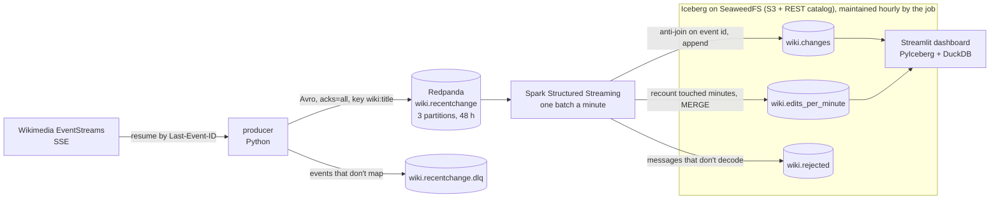

# Architecture on one page

Every change on every Wikimedia wiki (about 33 a second) goes from
Wikimedia's public event stream into Iceberg tables, each event exactly
once, and a dashboard reads the tables back. Everything runs in Docker
Compose on one laptop (4 cores, 7.5 GiB). The [README](../README.md) has
the detail; this page is the overview.

## What each part does

| Part | Job | Key setting |
|---|---|---|
| Producer | Reads the SSE stream, validates and maps each event to a 24-field Avro record, sends it to Redpanda; saves its resume position only after Redpanda has acknowledged everything sent | position saved every 5 s; contact required in the User-Agent |
| Redpanda | Kafka API and schema registry in one container; holds 48 hours of events, so anything downstream can be rebuilt from it | 3 partitions keyed by page; zstd |
| Spark job | One Structured Streaming query; `foreachBatch` writes each batch to the tables with idempotent operations, and runs maintenance between batches | 1 batch a minute, up to 200,000 events while catching up; checkpoint on a volume |
| Iceberg on SeaweedFS | ACID tables on S3-compatible storage behind a REST catalog, readable without Spark | partitioned by day |
| Dashboard | Reads the tables directly every 30 seconds and computes every number in DuckDB, in process | window anchored to the lake, not the clock |

## The guarantees, and what enforces them

| Guarantee | Mechanism | Evidence |
|---|---|---|
| The producer never skips an event | Resume position saved only after Redpanda acknowledged everything sent; a delivery failure exits without saving; a quiet datacenter resumes from the same moment as the busy one | `producer-crash` and `broker-outage` drills |
| Each event is in the lake exactly once | Copies within a batch dropped; events already in `changes` dropped by an anti-join on the event id; Spark replays an unfinished batch from its checkpoint, and the replay finds its work done | `job-crash` drill: six `kill -9`s mid-batch, nothing twice |
| Per-minute counts are exact, late events included | Every minute a batch touched is counted again from `changes` and merged in | 3,183 per-wiki minutes audited, all right |
| A bad message doesn't stop the job | Avro decoded in permissive mode; what doesn't decode goes to `wiki.rejected` with its offset, bytes and reason | `poison-message` drill |
| The tables don't rot | Hourly compaction of days that ended, and snapshot expiry (6 h) | `changes` from 421 files to 117 for about the same data; 1.5 to 1.0 GB on disk |
| Data loss is loud | The job refuses to start if Redpanda already deleted messages it never read | [runbook](runbook.md) |

All five drills ran twice against the live pipeline: ten passes, 79,150
messages audited ([results](../README.md#results)).

## Decisions and what they cost

| Decision | Why | What it costs |
|---|---|---|
| No watermark, no streaming state: the tables are the state | The producer replays history by design, and replays mix live events in. On day one a watermark followed those live events and dropped a whole replay as late | Each batch reads `changes` for the minutes it touched; ranges keep that to a few files |
| Count by recounting touched minutes, then MERGE | Late events correct their own minute; a replay counts to the same numbers | The minute table is copy-on-write: each MERGE rewrites today's file, so old versions pile up until snapshots expire |
| Key messages by `wiki:title` | One wiki (Commons) is 47% of traffic; keying by wiki would put it on one partition | No ordering per wiki, which nothing needs |
| Avro with a schema registry at the edge | A typed contract between producer and job; an event that doesn't fit goes to a dead-letter topic, not to the job | Producer and job must be deployed from the same commit when the schema changes |
| Partition `changes` by the day a change happened | Every time-range read, the dashboard's and the job's, opens only the days it asks for | Changes dated years back leave about one small file per old day, below compaction's threshold |
| Maintenance inside the stream job | No second JVM on a 7.5 GiB laptop; compacting only days that ended stays out of the way of the job's appends | Maintenance shares the job's memory and time |
| Dashboard reads the lake directly | No serving database to keep in sync; PyIceberg and DuckDB need no Spark | Every refresh scans; bounded by time filters and metadata-only status reads |
| SeaweedFS, Spark in local mode | One machine, real interfaces: S3, an Iceberg REST catalog with OAuth2, the standard Spark and Kafka clients | Not distributed; the same code would run on a cluster |

## Where to look

| Service | Address |
|---|---|
| Dashboard | http://localhost:8501 |
| Spark UI | http://localhost:4040 |
| Redpanda Console | http://localhost:8090 |
| Kafka API · schema registry | localhost:19092 · localhost:18081 |
| SeaweedFS S3 · Iceberg REST catalog | localhost:8333 · localhost:8181 |

`make peek` shows each table's rows, files, snapshots and footprint on disk,
and how far the job has got. What to do when something breaks is in the
[runbook](runbook.md).

## How it's tested

- 215 unit tests, no network or Docker: the producer against a byte-exact
  recording of the stream, the stream job on a local Spark (replays, crashes
  between writes, events from 2009), the dashboard headless over real
  Iceberg tables.
- In CI, a round trip through a real Redpanda, and an end-to-end run of the
  whole stack in Docker: events in, the same events in Iceberg, poison
  messages set aside, maintenance run, the dashboard rendered.
- On the laptop, the five failure drills against the live stream.
